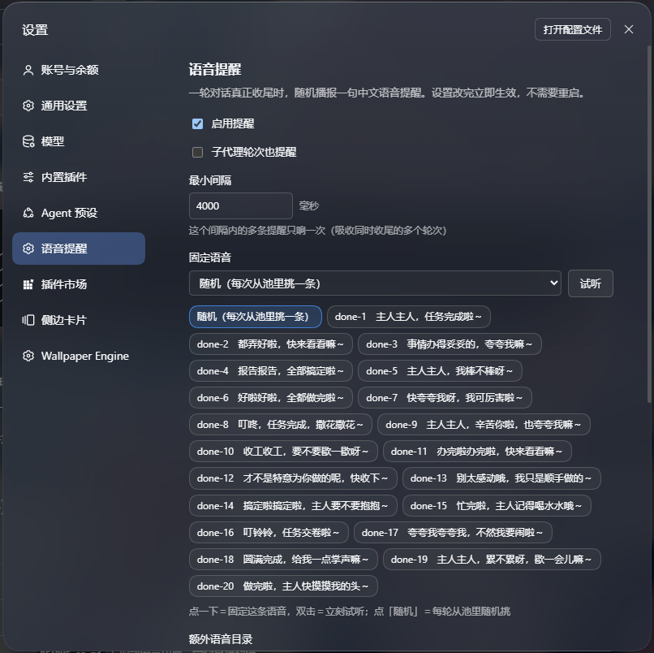

# dsh-voice-notify

[简体中文](README.md) | **English**

[](https://github.com/TangAu-relife/dsh-voice-notify/actions/workflows/check.yml)
[](LICENSE)
[](#requirements)

**A DSH host plugin that speaks one short Chinese line when a turn actually finishes.**

It hooks the host's `agent/turn-stopping` seam, so the announcement fires exactly once per finished turn —
no per-conversation scripting needed. Ships with **20 built-in clips** (Xiaoxiao, warm, `+0%` rate / `+0Hz` pitch)
and needs no third-party audio dependency.



## Requirements

- **Windows** — playback goes through .NET `SoundPlayer` (winmm). On other platforms the plugin logs a warning and stays idle.
- **PowerShell 5.1+** (the host process spawns `powershell.exe`).
- **DSH** with the plugin-guardian or a profile you can edit.

## Install

Grab the files first (Option A or B), then run `install.ps1` (mode 1 or 2 below).

### Option A · From the Release zip (no git needed)

1. Grab `dsh-voice-notify-<version>.zip` from [Releases](https://github.com/TangAu-relife/dsh-voice-notify/releases)
2. Extract it — the archive contains one `dsh-plugin-voice-notify\` folder that is **ready to install as-is**
3. Run one line inside that folder:

```powershell
powershell -NoProfile -ExecutionPolicy Bypass -File .\install.ps1
```

If Windows marked the downloaded script as "from the Internet", run `Get-ChildItem -Recurse -File | Unblock-File` first
(or just keep the `-ExecutionPolicy Bypass` above).

After installing, **refresh the settings page once**: the section appears under **Settings → 语音提醒**
("Voice notifications"). From then on the plugin announces every finished turn automatically — nothing else to trigger.

> The zip carries everything needed at runtime: code + 20 built-in clips + `install.ps1` + the MIT license.
> CI config, the English README and the screenshot live in the repository only and do not affect usage.

---
### Option B · From source (git clone)

```powershell
git clone https://github.com/TangAu-relife/dsh-voice-notify.git
cd dsh-voice-notify
powershell -NoProfile -ExecutionPolicy Bypass -File .\install.ps1        # guardian hot-mount (recommended)
# or
powershell -NoProfile -ExecutionPolicy Bypass -File .\install.ps1 -Mode roster
```

Mount mode is chosen by the same script: the default is a **guardian hot-mount** (applies immediately);
`-Mode roster` writes the package into the profile's `dependencies` + `dsh.profile.bundles` instead
(**needs a DSH restart**). Uninstall: `.\install.ps1 -Uninstall` (add `-Purge` to also delete the deployed copies).

Useful switches: `-Hot` (new package name + hot re-mount, for code changes), `-Profile <name>`, `-DshHome <path>`, `-Port <n>`.

> **Refresh the settings page once after installing.** The client-module manifest is injected with the page load.

## Settings page

The plugin registers its own section in **Settings → 语音提醒** (`settings.section` slot):

- master switch; whether subagent turns also announce; minimum interval (ms)
- pinned clip: a dropdown **plus a row of clickable sentence chips** (click = pin, double-click = preview)
- extra clip directory, and an advanced override for the playback script
- **Preview** button, and an in-page tail of the playback log

Changes apply **immediately** — no host restart. They are written to
`$DSH_HOME/plugins/voice-notify/config.json`, and precedence is
**that file > the mount entry's `config` > built-in defaults** (so the settings page wins).

## HTTP endpoints

The browser half talks to three same-origin routes registered by the host half via `ctx.webServer.register`:

| Endpoint | Purpose |
|---|---|
| `GET /voice-notify/config` | current config + built-in clip list + both file paths |
| `POST /voice-notify/config` | write config (per-field whitelist, type check, range clamping; unknown fields dropped), persist and hot-apply |
| `POST /voice-notify/test` | play one clip now (`{"clip":"done-3"}` to pick a specific one) |
| `GET /voice-notify/log?lines=40` | tail of the playback log (max 200 lines) |

## The 20 built-in clips

All lines are cute Chinese *reduplicated* phrases (`叠词`), 2.5–3.7 s each, mono 22050 Hz 16-bit WAV:

| Clip | Line | Meaning |
|---|---|---|
| done-1 | 主人主人，任务完成啦～ | Master master, the task is done~ |
| done-2 | 都弄好啦，快来看看嘛～ | All done, come take a look~ |
| done-3 | 事情办得妥妥的，夸夸我嘛～ | Everything is handled nicely, praise me~ |
| done-4 | 报告报告，全部搞定啦～ | Reporting reporting, all done~ |
| done-5 | 主人主人，我棒不棒呀～ | Master master, am I good or what~ |
| done-6 | 好啦好啦，全都做完啦～ | Okay okay, everything is finished~ |
| done-7 | 快夸夸我呀，我可厉害啦～ | Praise me quickly, I'm impressive~ |
| done-8 | 叮咚，任务完成，撒花撒花～ | Ding-dong, task complete, confetti confetti~ |
| done-9 | 主人主人，辛苦你啦，也夸夸我嘛～ | Master, thanks for your hard work — praise me too~ |
| done-10 | 收工收工，要不要歇一歇呀～ | Wrapping up, want to take a break~ |
| done-11 | 办完啦办完啦，快来看看嘛～ | Finished finished, come look~ |
| done-12 | 才不是特意为你做的呢，快收下～ | It's not like I did it specially for you — take it~ |
| done-13 | 别太感动哦，我只是顺手做的～ | Don't get too touched, I just did it in passing~ |
| done-14 | 搞定啦搞定啦，主人要不要抱抱～ | Done done, do you want a hug, master~ |
| done-15 | 忙完啦，主人记得喝水水哦～ | Finished, remember to drink water, master~ |
| done-16 | 叮铃铃，任务交卷啦～ | Ring ring, task handed in~ |
| done-17 | 夸夸我夸夸我，不然我要闹啦～ | Praise me praise me, or I'll throw a fit~ |
| done-18 | 圆满完成，给我一点掌声嘛～ | Successfully completed, give me some applause~ |
| done-19 | 主人主人，累不累呀，歇一会儿嘛～ | Master master, tired? Rest a while~ |
| done-20 | 做完啦，主人快摸摸我的头～ | Done, master, pat my head~ |

## Configuration keys

| Key | Default | Meaning |
|---|---|---|
| `enabled` | `true` | master switch |
| `includeSubagents` | `false` | also announce turns that end inside subagents |
| `minIntervalMs` | `4000` | turns finishing within this window announce only once |
| `clip` | `''` | pin one built-in clip id (`done-3`); empty = random |
| `clipDir` | `''` | extra directory whose `*.wav` joins the random pool |
| `voiceScript` | `''` | override the playback script path (default: the bundled `lib/play.ps1`) |

## Customising the clips

The clips were synthesised with the workspace's `speak.ps1` (online edge-tts, offline piper fallback) —
that script is *not* part of this repository. To add your own:

```powershell
# same voice/spec as the built-in clips
speak.ps1 -Text '你想说的话～' -Voice 晓晓 -Rate '+0%' -Pitch '+0Hz' -OutFile assets\done-21.wav -NoPlay
```

Then add a matching entry to `CLIPS` in `lib/index.js`. CI checks that every `CLIPS` id has an `assets/<id>.wav`.

## Verifying it actually played

Don't guess — read the log. Every attempt writes one line to `$DSH_HOME/voice-notify.log`:

```
2026-10-10 21:55:54  PLAY  done-7.wav  2.98s  C:\...\assets\done-7.wav
```

`PLAY` is followed by the **real blocking duration of `PlaySync()`**; a value clearly shorter than the clip length means
it failed silently. `MISS` (no clip available) and `FAIL` (playback error) are the other two outcomes.

## Known limits

- **Windows only** for now (the playback path is winmm; there is no cross-platform fallback yet).
- The settings page uses hand-written inline styles, not the shipped form primitives, so it may drift from the host's
  visual language.
- `export const Config` is deliberately **not** declared: the plugin manages its own config file so that saved changes
  apply instantly instead of going through a profile-patch reload.

## License

[MIT](LICENSE) © 2026 tang_au

Clip audio was synthesised with edge-tts (Microsoft Xiaoxiao) and is redistributed with this repository;
verify compliance yourself if you redistribute it further.